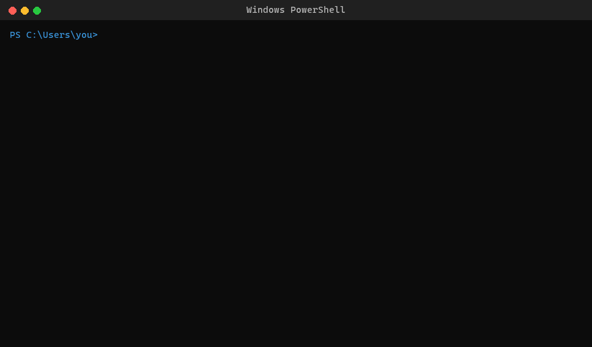
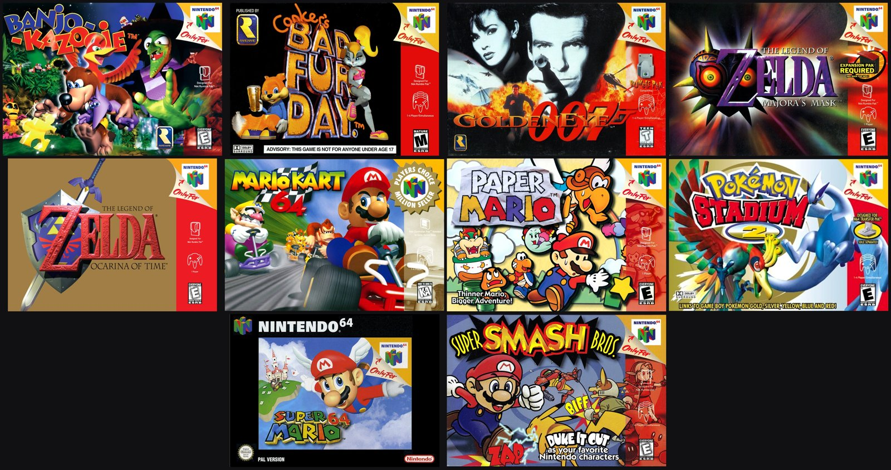

# fetchart

Find and download game art, movie and TV posters, album covers, paintings, Pokémon, Minecraft skins, anime, book covers and app icons from the command line. No API keys or accounts are needed.

For games, it covers about 190,000 titles on every platform: front and back covers, 3D boxes, discs and cartridges, screenshots, old magazine ads, key art (with or without the logo), see-through logos, console dashboard tiles, and achievement and trophy icons for Xbox, PlayStation, Steam and retro consoles.

It also works on whole libraries: art for every ROM in a folder, posters for a Plex or Jellyfin movie folder, covers for a music folder, Steam library art for your non-Steam games, and a "box wall" poster of a whole collection. And it can set any of it as your wallpaper, or give you a new one every day.



Just type `fetchart` in PowerShell, Command Prompt or any terminal, and pick what you're looking for from the menu.

Type the name, then pick the right one from the matches. Each game appears once, and you pick the platform after it. Then pick the kind of art, choose from every image found (biggest first), and pick a folder. For key art, also pick its shape: landscape, portrait, a phone wallpaper, or ultrawide (21:9 or 32:9). fetchart remembers the last folder you used.

**Controls:** use the arrow keys or click with the mouse, and press Enter. Typing a number jumps to it. On the image and achievement lists, press **P** to see every option as a numbered picture in your browser. For achievements, Space (or a click) ticks as many as you want, and A ticks them all. Mouse clicks work in the Windows console; on macOS and Linux, use the keys.

### A whole folder of games


Point fetchart at a folder of ROMs and it gets art for every game, saved under each ROM's own file name, as EmulationStation, RetroArch and other frontends expect:

```
fetchart --folder D:\ROMs\N64
```

- It reads No-Intro and Redump style names: `Legend of Zelda, The - Ocarina of Time (USA) (Rev 1).z64` is The Legend of Zelda: Ocarina of Time.
- The system comes from the file extension or the folder's name (`N64`, `snes`, `PS2`, `Sega Genesis`...). You can also give it: `fetchart --folder D:\ROMs\Discs ps1`.
- A `(Europe)` ROM gets the European box when there is one.
- Games that already have art are skipped, so running it again only fills the gaps.
- If a name isn't a sure match, fetchart asks you to pick the right game at the end, or skips it with `-y`.

The art goes in a folder inside the ROM folder, named the way ES-DE names them: `covers`, `backcovers`, `3dboxes`, `physicalmedia`, `screenshots`, `fanart`, `marquees` (logos), plus `keyart`, `icons` and `flyers`. `-o` picks another.

### Box wall



One big 4K poster of a whole collection:

```
fetchart --collage D:\ROMs\N64
fetchart --collage D:\ROMs\N64 -w
```

It uses the pictures in the folder, or its `covers` folder. A ROM folder with no art yet gets its box art first. Add `-w` to make it your wallpaper.

### A folder of movies or TV shows

Point it at your Plex, Jellyfin, Emby or Kodi library and every movie and show gets a poster:

```
fetchart --folder D:\Movies
```

- A movie or show in its own folder gets `poster.jpg` inside it. A loose movie file gets `<file name>-poster.jpg` next to it.
- It reads the names people actually use: `Inception (2010)`, `The.Matrix.1999.1080p.BluRay.x264`, `Dune (2021) {imdb-tt1160419}`.
- A folder with `Season 1` folders or `S01E01` files is a TV show.
- Anything that already has a poster is skipped. Anything that isn't a sure match (like `Dune` with no year) is asked about at the end.

In Plex, turn on **Use local assets** for the library so it picks the posters up.

### A folder of music

```
fetchart --folder D:\Music
```

Every album folder gets a `cover.jpg`, which Plex, Jellyfin, Navidrome, Kodi, foobar2000 and MusicBee all pick up. The artist and album come from the files' tags (MP3 and FLAC), or else from the folder names (`Artist\Album` or `Artist - Album (2003)`). Covers come from Apple Music at up to 3000x3000, or Deezer. Albums that already have a cover are skipped.

### A list of names

Put one name per line in a text file. Add a comma and a platform, or `movie`, `album`, `pokemon` and so on, when it isn't a game:

```
halo 3, x360
mw2 2009
inception, movie
the dark side of the moon, album
mewtwo, pokemon
```

```
fetchart --list wishlist.txt -t box -o D:\Art
```

fetchart takes the top match and the best picture for each line, and lists the ones it couldn't find at the end.

### Steam art for non-Steam games

Games you add with **Add a Non-Steam Game** (emulators, Epic, Game Pass, old discs) show up in Steam as blank tiles. This fills them in:

```
fetchart --steam
```

Each game gets the four pictures Steam's library uses: the cover, the wide cover, the background, and the logo. Games that are also sold on Steam get the official Steam art, and everything else comes from LaunchBox. Art you already set yourself is never replaced. Restart Steam afterwards to see it.

If Steam isn't in its usual place, give its folder: `fetchart --steam "D:\Steam"`.

### Wallpaper

Add `-w` and fetchart sets the picture as your desktop background (Windows, macOS, and GNOME, KDE or Xfce on Linux):

```
fetchart halo-3 x360 -w
fetchart "the starry night" painting -w
```

For games it uses key art without the logo (`-t logo` keeps the logo) and asks which screen it's for: a normal one, an ultrawide (21:9), a super ultrawide or two monitors (32:9), or a phone, which is only saved. For paintings it uses a 4K copy instead of the giant museum scan.

**A new wallpaper every day:**

```
fetchart --daily "halo 3, celeste, elden ring"
fetchart --daily n64
fetchart --daily
fetchart --daily off
```

You can give it some games, a platform (its most popular games), or nothing (popular games from everywhere). It changes the wallpaper right away, then every morning, or the first time the computer is on that day. Windows uses Task Scheduler, macOS uses launchd, and Linux uses a systemd user timer.

To go back to the wallpaper you had before, run `fetchart --undo-wallpaper`, even after several `-w` runs or daily changes (it turns the daily wallpaper off too). fetchart keeps a copy of your old picture, so it works even if the original file is gone. A Windows slideshow or Spotlight comes back as the single picture that was showing.

### Pokémon, Minecraft skins, anime, books and apps

Use the word in place of a platform, or pick it from the menu:

```
fetchart charizard pokemon
fetchart Notch minecraft
fetchart attack-on-titan anime
fetchart berserk manga
fetchart "the hobbit" book
fetchart minecraft app
```

| Search | What you get | Where it comes from |
|---|---|---|
| Pokémon | Official artwork, Pokémon HOME renders, animated sprites, and every game's sprite from Red and Blue on (scaled up with sharp pixels), shiny ones too | [PokéAPI](https://pokeapi.co/) |
| Minecraft | A 3D render of the player's head, their whole body, their face, the skin file itself, and their cape | Mojang |
| Anime / manga | Cover and banner | [AniList](https://anilist.co/) |
| Books | The cover, plus other editions' covers | [Open Library](https://openlibrary.org/) |
| Apps | The 1024x1024 App Store icon and full-size screenshots | Apple App Store |

## Install

### Windows, macOS, Linux: standalone download

Grab the file for your system from the [latest release](https://github.com/SamuelArther/fetchart/releases/latest):

| System  | File                   |
|---------|------------------------|
| Windows | `fetchart-windows.exe` |
| macOS   | `fetchart-macos`       |
| Linux   | `fetchart-linux`       |

You can double-click it and it will show the menus. To use `fetchart` as a command in any terminal, rename the file to `fetchart` (`fetchart.exe` on Windows) and put it in a folder on your `PATH`.

On macOS and Linux, make the file runnable first:

```
chmod +x fetchart-macos
```

On macOS you may also need to right-click it and choose **Open** the first time, because the build isn't signed.

### With Homebrew (macOS, Linux, or brew-windows)

```
brew install samuelarther/tap/fetchart
```

It builds from the PyPI package with Homebrew's Python and Pillow on macOS and Linux. On Windows, [brew-windows](https://github.com/SamuelArther/brew-windows) installs the standalone build.

### With Python (3.9+)

```
pipx install fetchart
```

`pip install fetchart` works too.

## Usage

Run `fetchart` with no arguments for the menus above. To skip them, put everything on one line:

```
fetchart <game> [platform] [options]
```

Game names can use dashes or quotes: `halo-3` and `"halo 3"` both work. If you leave out the platform, every platform is searched.

Short names work too: `mw2`, `bo2`, `botw`, `oot`, `gta5`, `ff7`, `csgo`, `ssbm`, or a mix like `mw2 remastered`. When a name was used twice, add the year: `mw2 2009` is the original Modern Warfare 2, and `mw2 2022` is the remake.

| Option | What it does |
|---|---|
| `-t TYPE` | Skip the art-type menu (types are listed below) |
| `-r landscape\|portrait\|phone\|ultrawide\|superwide` | The shape, for key art |
| `-q low\|medium\|high\|all\|1920x1080` | Skip the "which one" menu |
| `-o FOLDER` | Where to save |
| `-y` | No prompts: take the top match and the best image |
| `-w` | Set the picture as your desktop wallpaper |
| `--undo-wallpaper` | Put back the wallpaper you had before |
| `--daily [GAMES\|PLATFORM\|off]` | A new game wallpaper every day (see above) |
| `-f FOLDER` | Get art for every game, movie, show or album in a folder (see above) |
| `--collage FOLDER` | Make a box wall poster (see above) |
| `--list FILE` | Get art for every name in a text file (see above) |
| `--steam` | Fill in Steam's library art for your non-Steam games (see above) |
| `--completion powershell\|bash\|zsh` | Print the Tab completion script (see below) |
| `--update` | Re-download the game database |

### Tab completion

Press Tab to complete options, art types, shapes and platforms. Set it up once:

| Shell | Run this once |
|---|---|
| PowerShell | `fetchart --completion powershell >> $PROFILE` |
| bash | `echo 'eval "$(fetchart --completion bash)"' >> ~/.bashrc` |
| zsh | `echo 'eval "$(fetchart --completion zsh)"' >> ~/.zshrc` |

Then open a new terminal.

### Examples

```
fetchart super-mario-odyssey switch -t box
fetchart halo-3 x360 -t icon -q all -o "D:\Art\Halo 3"
fetchart zelda-ocarina-of-time n64 -t clean -r portrait
fetchart gears-of-war -t ach
fetchart uncharted-2 ps3 -t ach
fetchart hollow-knight pc -t clearlogo
fetchart super-mario-64 n64 -t flyer
fetchart elden-ring pc -t logo -r phone
```

### Movies, TV, albums and paintings

Use `movie`, `tv`, `album` or `painting` in place of a platform:

```
fetchart inception movie
fetchart breaking-bad tv
fetchart "pink floyd dark side of the moon" album
fetchart "the starry night" painting
```

| Type | Where it comes from | Typical size |
|---|---|---|
| Movie / TV posters | IMDb, Wikipedia | up to 2000x3000 |
| Album covers | Apple Music, Deezer, Cover Art Archive | 1200–3000 px |
| Paintings | Wikimedia Commons museum scans | the full scan, plus 3840 and 1920 wide copies |

Some museum scans are huge (The Starry Night is 663 MB), so the menu shows the file size of big originals.

For albums, the artist plus the album name finds the right one fastest.

### Platforms

`pc`, `xbox`, `x360`, `xboxone`, `series`, `ps1`, `ps2`, `ps3`, `ps4`, `ps5`, `psp`, `vita`, `nes`, `snes`, `n64`, `gc`, `wii`, `wiiu`, `switch`, `switch2`, `gb`, `gbc`, `gba`, `ds`, `3ds`, `genesis`, `sms`, `gg`, `saturn`, `dc`, `segacd`, `32x`, `tg16`, `neogeo`, `2600`, `jaguar`, `lynx`, `3do`, `arcade`, `dos`, `mac`, `linux`, `android`, `ios`.

Full names work too, e.g. `"Sega Dreamcast"`.

## Art types

| Type | What you get | Where it comes from |
|---|---|---|
| **box** | The front cover from every region, rating and all | LaunchBox Games Database |
| **back** | The back of the box | LaunchBox |
| **box3d** | The whole box at an angle, see-through background | LaunchBox |
| **disc** | The disc or cartridge | LaunchBox |
| **screenshot** | Gameplay screenshots and the title screen | LaunchBox |
| **flyer** | Old magazine and store ads | LaunchBox |
| **clean** | Key art without the logo, in any shape (landscape, portrait, phone, 21:9, 32:9) | LaunchBox fanart, Steam library art |
| **logo** | Key art with the logo | Steam capsules, LaunchBox banners and posters, or fanart with the game's logo laid on top |
| **clearlogo** | Just the logo, as a PNG with a see-through background | Steam library logos, LaunchBox clear logos |
| **icon** | The square tile on the console's menu | See below |
| **ach** | Achievement or trophy icons, listed by name, score and description. Pick one, a few (`1,4,9` or `10-20`), or all of them | See below |
| **wallpaper** | The best landscape key art, set as your desktop background | Same as **clean** |

Achievements and trophies, by platform:

| Platform | What you get | Where it comes from |
|---|---|---|
| Xbox 360 | Achievements with gamerscore, plus the game icon | Original icons from the Xbox Live image server, names from Exophase |
| Xbox One / Series | Achievements with gamerscore | Exophase |
| PS3 / PS4 / PS5 / Vita | Trophies with their grade (Platinum, Gold...), at 240x240 | Exophase |
| PC | Steam achievements (or Xbox PC, GOG, Epic) | Exophase |
| NES, SNES, N64, GameCube, Wii, Game Boy, DS, Genesis, PS1, PS2, PSP and other retro systems | [RetroAchievements](https://retroachievements.org/) sets | Exophase |

Where the **icon** art comes from, by platform:

| Platform | Icons |
|---|---|
| Xbox 360 / original Xbox | The back-compat tile with the green console stripe, the 360 dashboard banner, the dashboard box art, and the game icon from the guide (plus an upscaled copy) |
| Xbox One / Series / PC | The Microsoft Store square tile |
| Switch / 3DS / Wii U | The eShop icon |
| PC (Steam) | The Steam library icon |

## How it works

The first run downloads the public [LaunchBox Games Database](https://gamesdb.launchbox-app.com/) dump (~110 MB). It indexes the dump into a local SQLite file, and then refreshes it every 30 days. That takes about 20 seconds.

The index is stored at:

| System | Location |
|---|---|
| Windows | `%LOCALAPPDATA%\fetchart` |
| macOS / Linux | `~/.cache/fetchart` |

Xbox 360 title IDs are looked up through [XboxUnity](http://xboxunity.net/).

## Credits and disclaimer

The art comes from the LaunchBox Games Database community, Steam, the Microsoft Store, Xbox Live, XboxUnity, Exophase, RetroAchievements, Nintendo, IMDb, Wikipedia, Wikimedia Commons, Deezer, Apple Music, MusicBrainz / the Cover Art Archive, PokéAPI, Mojang, AniList, Open Library and the App Store. Thanks to all of them for keeping it online.

All art belongs to its respective owners. fetchart is meant for personal use, such as emulator frontends, media servers, desktop wallpapers and collection catalogs. It is not affiliated with any of the sites it pulls from, or with any game, film or music company.

## License

[MIT](LICENSE)
